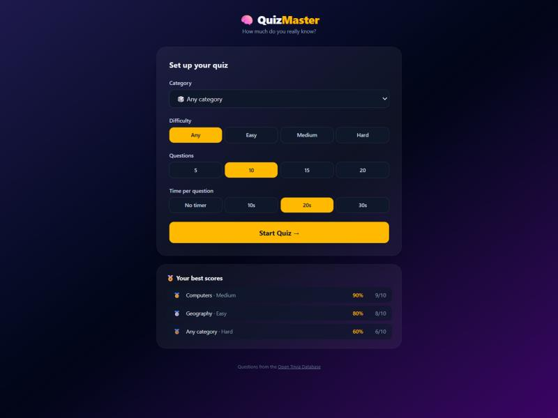
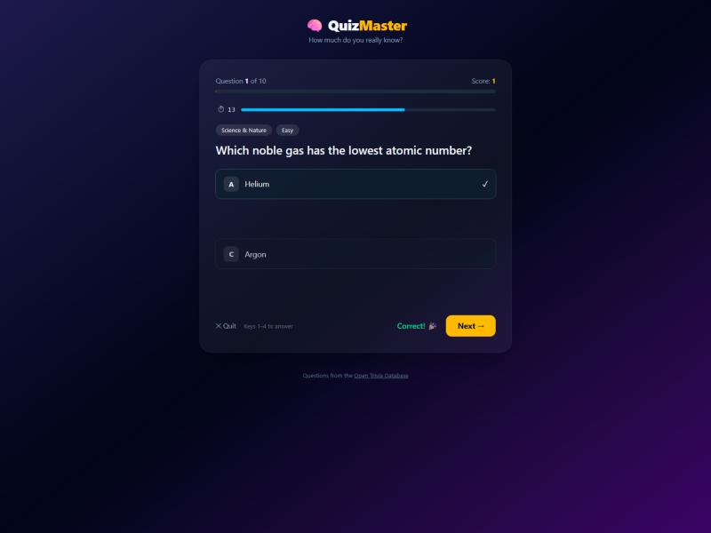
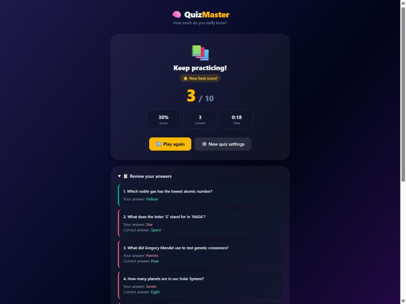

# 🧠 QuizMaster: Trivia Quiz App

A fast, fun trivia quiz with 24 categories, three difficulty levels, a timer, a 50:50 lifeline and high scores.
Built with **React, TypeScript, Tailwind CSS and TanStack Query**, and tested with **Vitest + React Testing Library** (47 tests).

This is **Day 6** of my daily project challenge, where I build one project every day, from simple to advanced.

🔗 **Live demo:** https://gopichandreddy007.github.io/quiz-app/

| Setup | Question | Results |
| ----- | -------- | ------- |
|  |  |  |

## Features

- **24 categories** from the Open Trivia Database, or "Any category"
- **Difficulty**: any, easy, medium or hard
- **5, 10, 15 or 20 questions**
- **Timer** per question (10s / 20s / 30s, or off). When it runs out, the question counts as wrong
- **50:50 lifeline**: removes two wrong answers, once per quiz
- Instant feedback: the right answer turns green, a wrong pick turns red
- **Results** with score, percent, time taken and a message that matches how you did
- **Answer review**: every question with your answer and the correct one
- **High scores** for each category and difficulty, saved in your browser, with a "New best score!" badge
- **Keyboard**: press `1`-`4` (or `A`-`D`) to answer and `Enter` for the next question
- Friendly messages when there aren't enough questions or the API's rate limit is hit
- Responsive design for phones and desktops

## Tech Stack

| | |
|---|---|
| UI | React 19, TypeScript, Tailwind CSS v4 |
| Data | TanStack Query (`useQuery` for categories, `useMutation` for questions) |
| State | `useReducer` quiz reducer, custom `useCountdown` hook |
| Tests | Vitest, React Testing Library, user-event, jsdom |
| API | [Open Trivia Database](https://opentdb.com/), free, no key needed |
| Deploy | GitHub Actions runs the tests, then publishes to GitHub Pages |

## Tests

```bash
npm test
```

| Test file | What it checks |
| --- | --- |
| `lib/api.test.ts` | URL building, decoding, shuffling, API error codes (including rate limits) with a mocked `fetch` |
| `lib/quiz.test.ts` | Answering, time up, next/finish, 50:50 only once and never hiding the right answer |
| `lib/highScores.test.ts` | Keeping only the best score per category and difficulty |
| `lib/results.test.ts` | Percent, messages and time formatting |
| `hooks/useCountdown.test.ts` | Counting down, freezing and resetting, using fake timers |
| `components/QuestionCard.test.tsx` | Clicking options, locking after answering, hidden 50:50 options |
| `App.test.tsx` | Full quiz flows as a user: settings sent to the API, playing to the end, review, high scores, keyboard, errors |

## Project Structure

```
src/
├── lib/                     # plain TypeScript logic, easy to test
│   ├── api.ts               # Open Trivia DB calls, decoding, shuffling
│   ├── quiz.ts              # quiz reducer (answer, time up, next, 50:50)
│   ├── highScores.ts        # best scores in localStorage
│   ├── results.ts           # percent, message, duration
│   └── types.ts
├── hooks/
│   └── useCountdown.ts      # per-question timer
├── components/
│   ├── SetupScreen.tsx
│   ├── QuizScreen.tsx
│   ├── QuestionCard.tsx
│   ├── TimerBar.tsx
│   ├── ResultsScreen.tsx
│   ├── AnswerReview.tsx
│   └── HighScores.tsx
├── test/                    # test setup and helpers
└── App.tsx
```

## Run Locally

```bash
git clone https://github.com/gopichandreddy007/quiz-app.git
cd quiz-app
npm install
npm run dev
```

| Command | What it does |
| --- | --- |
| `npm run dev` | Start the dev server |
| `npm test` | Run all tests once |
| `npm run test:watch` | Re-run tests when files change |
| `npm run build` | Type-check and build into `dist/` |
| `npm run lint` | Check the code with oxlint |

## What I Learned

- Testing components the way a user uses them with **React Testing Library** (roles, clicks, keyboard) instead of testing internals
- Mocking `fetch` so tests never call the real API
- Testing timers instantly with **fake timers**
- **TanStack Query**: `useQuery` for data you read and cache, `useMutation` for actions like "start a new quiz"
- Modelling the quiz as a **reducer**, which makes rules like "50:50 only once" easy to test
- Resetting state when a prop changes the way React recommends (during render, not in an effect)
- Hiding elements with `visibility: hidden` so they're also hidden from screen readers and tests
- A real API doesn't always match its docs: Open Trivia DB rate limits with HTTP 429, not only `response_code: 5`

## Future Ideas

- True/false questions
- Streak bonus points for fast answers
- Share your score as an image
- Multiplayer mode on one device
